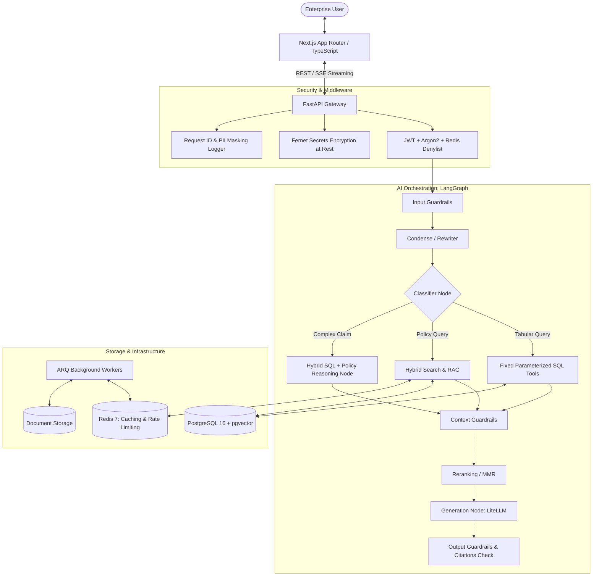

# Enterprise Insurance Claims & Policy Intelligence Assistant

A production-grade, login-protected AI assistant web application for enterprise insurance employees. The system intelligently determines whether to answer queries using **deterministic SQL database tools**, **unstructured policy document RAG**, or a **hybrid reasoning pipeline** that fuses both data sources with strict factual grounding.

---

## 🏛 Architecture Overview



---

## 📁 Repository Layout

```
insurance-genai/
├── .github/
│   └── workflows/
│       └── ci.yml                 # GitHub Actions CI (lint, mypy, pytest, eslint, tsc)
├── backend/
│   ├── app/
│   │   ├── main.py                # FastAPI factory, lifespan, CORS, error handlers
│   │   ├── core/                  # config, security (Argon2, Fernet, JWT), logging, exceptions
│   │   ├── api/                   # deps.py, v1/ (health, auth, claims, search, chat, etc.)
│   │   ├── db/                    # base (DeclarativeBase), session, migrations/ (Alembic async)
│   │   ├── models/                # SQLAlchemy ORM models
│   │   ├── schemas/               # Pydantic v2 validation schemas
│   │   ├── repositories/          # Database repositories
│   │   ├── services/              # Business domain services
│   │   ├── ai/                    # LangGraph, LiteLLM, embeddings, chunking, retrieval, guardrails, eval
│   │   ├── cache/                 # Redis async client, keys, decorators
│   │   └── workers/               # ARQ worker settings and background ingestion tasks
│   ├── scripts/                   # init_pgvector.sql, load_csvs.py, seed_admin.py, run_eval.py
│   ├── tests/                     # unit/, integration/, eval/, conftest.py
│   ├── alembic.ini                # Alembic migration configuration
│   ├── pyproject.toml             # Python build config, ruff, mypy, pytest
│   └── Dockerfile                 # Backend container definition
├── frontend/
│   ├── src/
│   │   ├── app/                   # Next.js App Router (layout, page, login, chat, etc.)
│   │   ├── components/            # UI components and layout widgets
│   │   ├── lib/                   # axios instance with 401 interceptor, cn helper
│   │   ├── services/              # API clients
│   │   ├── hooks/                 # React hooks
│   │   ├── stores/                # Zustand client stores
│   │   ├── types/                 # Shared TypeScript interfaces
│   │   └── middleware.ts          # Next.js route protection middleware
│   ├── package.json               # Dependencies and scripts
│   ├── tsconfig.json              # TypeScript configuration
│   ├── tailwind.config.ts         # Tailwind design tokens
│   ├── postcss.config.mjs         # PostCSS configuration
│   ├── next.config.mjs            # Next.js configuration
│   └── Dockerfile                 # Multi-stage frontend container
├── docker-compose.yml             # Postgres (pgvector), Redis, Backend, Worker, Frontend
├── .env.example                   # Exhaustive configuration template
├── .gitignore
└── README.md
```

---

## 📦 Dependency List

### Backend (Python 3.11+)
- **Core Framework:** `fastapi>=0.115.0`, `uvicorn[standard]>=0.30.0`, `pydantic>=2.9.0`, `pydantic-settings>=2.5.0`
- **Database & Vectors:** `sqlalchemy>=2.0.35`, `asyncpg>=0.29.0`, `pgvector>=0.3.2`, `alembic>=1.13.2`
- **Cache & Async Queue:** `redis>=5.0.8`, `arq>=0.26.0`
- **Security & Cryptography:** `pyjwt>=2.9.0`, `argon2-cffi>=23.1.0`, `cryptography>=43.0.0`
- **AI Orchestration & Providers:** `langgraph>=0.2.20`, `langchain-core>=0.3.0`, `litellm>=1.49.0`, `sqlglot>=25.20.0`
- **Document Ingestion:** `pypdf>=4.3.0`, `python-docx>=1.1.2`, `markdown>=3.7`
- **Quality & Testing:** `pytest>=8.3.0`, `pytest-asyncio>=0.24.0`, `ruff>=0.6.8`, `mypy>=1.11.2`

### Frontend (Node.js 20+ / Next.js 14)
- **Framework & Core:** `next: 14.2.15`, `react: ^18.3.1`, `react-dom: ^18.3.1`, `typescript: ^5.6.2`
- **State & Data Fetching:** `@tanstack/react-query: ^5.59.0`, `zustand: ^5.0.0`, `axios: ^1.7.7`
- **Styling & UI:** `tailwindcss: ^3.4.13`, `clsx`, `tailwind-merge`, `class-variance-authority`, `lucide-react`
- **Tooling:** `eslint`, `eslint-config-next`, `postcss`, `autoprefixer`

---

## 🚀 Quickstart & How to Run

### Option 1: Docker Compose (All-in-One)

1. Copy `.env.example` to `.env`:
   ```bash
   cp .env.example .env
   ```
2. Start all services:
   ```bash
   docker compose up -d
   ```
3. Access services:
   - **Frontend:** http://localhost:3000
   - **Backend API Docs:** http://localhost:8005/docs
   - **Health Check:** http://localhost:8005/api/v1/health

### Option 2: Local Development Setup

#### Backend Setup
```bash
# In backend directory
python -m venv .venv
source .venv/bin/activate  # On Windows: .venv\Scripts\activate
pip install -e ".[dev,test]"

# Run tests
pytest -v tests/

# Start FastAPI dev server
uvicorn app.main:app --host 0.0.0.0 --port 8005 --reload
```

#### Frontend Setup
```bash
# In frontend directory
npm install
npm run dev
```

---

## 🧪 Verification & Testing (Phase 0)

1. **Backend Tests:**
   ```bash
   pytest tests/
   ```
2. **Frontend Type Check:**
   ```bash
   cd frontend && npm run typecheck
   ```
3. **Health Endpoint Check:**
   ```bash
   curl http://localhost:8005/api/v1/health
   ```
